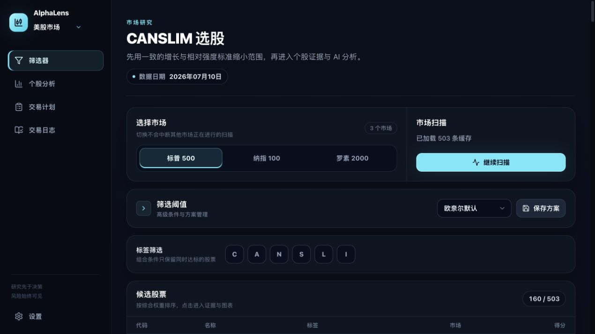
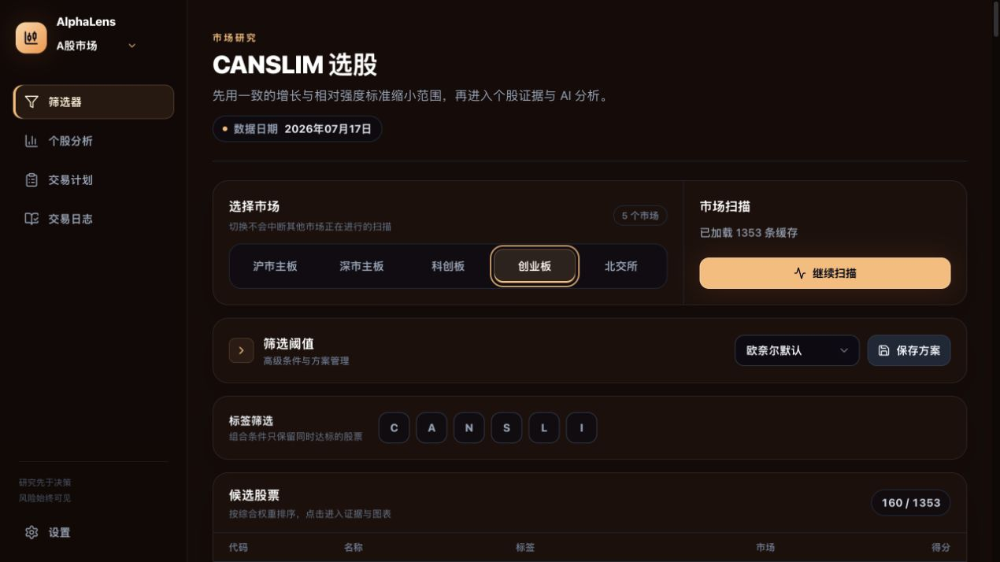
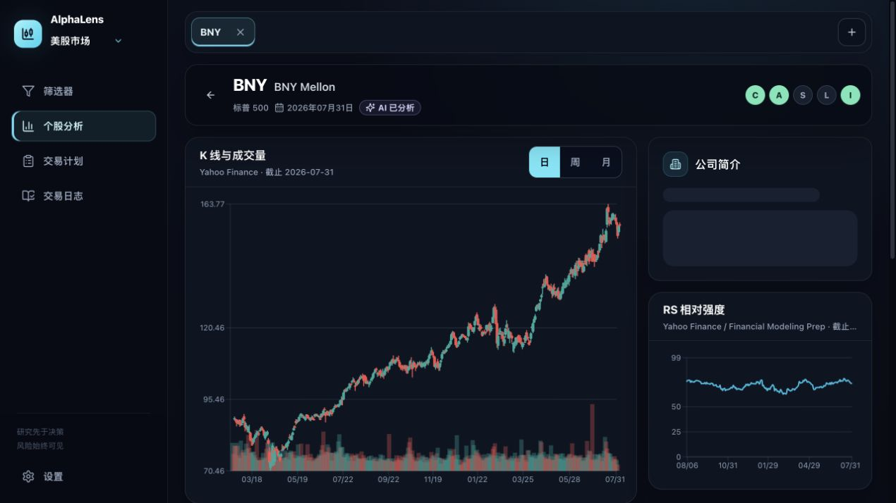
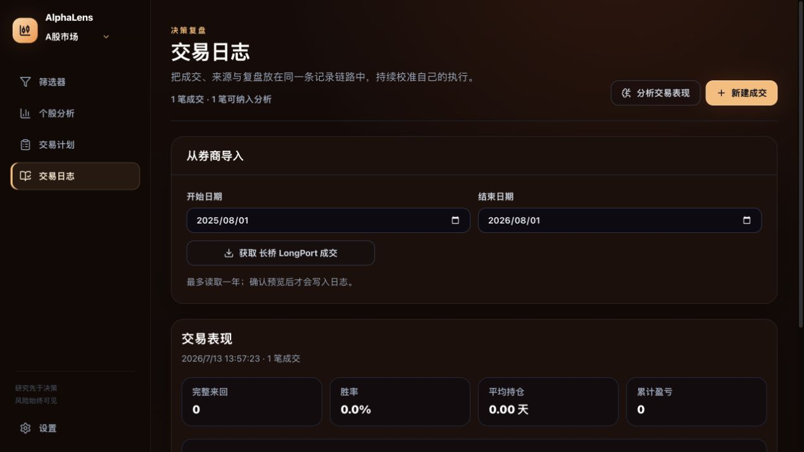
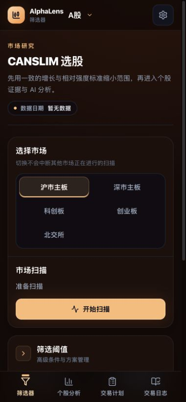

<p align="center">
  
</p>

<p align="center">
  <a href="#快速体验"></a>
  <a href="ios/README.md"></a>
  <a href="#架构概览"></a>
  <a href="docs/images/ios/README.md"></a>
</p>

> 跨市场、本地优先、证据可追溯的投资研究与决策支持工具。

AlphaLens是一款覆盖美股与 A 股的本地优先投资研究工具。它把分散的选股、证据核查、AI 多视角讨论、交易计划与复盘连接成一条可追溯的工作流，帮助使用者更有依据地做判断，而不是替使用者做决定。产品同时提供 Web 工作台与[原生 iOS 客户端](ios/README.md)，共享同一套数据含义和 REST/SSE 契约。



## 产品要解决的问题

投资研究并不缺信息，真正稀缺的是一条可信、连续的决策链路：

| 用户问题 | 常见后果 | AlphaLens 的产品回应 |
| --- | --- | --- |
| 行情、财报、新闻与机构数据分散 | 来回切换工具，研究口径不一致 | 用 CANSLIM 统一初筛，再进入同一标的的证据工作台 |
| AI 会给结论，但证据来源与冲突不透明 | 很难判断结论是否值得相信 | 在分析前审计来源、期间与冲突，缺失信息明确显示为未知 |
| 看多 / 看空观点容易单边强化 | 忽略反方证据与风险条件 | 让多角色分别研究、辩论和审阅，最终决策仍由人完成 |
| 研究、计划、成交与复盘彼此割裂 | 很难从真实执行中修正行为 | 把交易计划、只读成交导入和复盘放进同一条记录链路 |

## 产品闭环

```text
发现标的 → 核查证据 → 多视角讨论 → 人工决策 → 记录执行 → 交易复盘
```

AlphaLens 不自动下单，也不把 AI 输出包装成交易信号。产品的核心价值是降低研究摩擦、暴露证据边界，并让使用者保留最终判断权。

## Demo

### 1. 从跨市场候选池发现标的

美股与 A 股使用各自独立的数据路由、股票池和视觉主题。用户可以用同一套 CANSLIM 语言筛选，但不会把 SEC、美国内部人或美股期权等证据错误套用到 A 股。

| 美股市场 | A 股市场 |
| --- | --- |
|  |  |

筛选结果不会只给一个总分。C、A、N、S、L、I 标签分别保留达标状态和原始值，用户可以继续追问“为什么入选”。

### 2. 在同一页面核查价格、增长与相对强度

点击候选标的后，价格走势、成交量、RS 相对强度、EPS、营收、毛利率、公司资料与来源日期会集中展示。缺失或失败的图表会保持真实错误状态，不用伪造数据填满界面。



### 3. 让 AI 输出成为可审阅的研究过程

AI 分析不是一次性问答，而是一个带角色分工的研究流程：基本面、技术、新闻和情绪分析师先形成证据，再由看多 / 看空研究员、交易员、风险角色和投资组合经理逐层审阅。

在证据进入分析前，确定性的 `DataAuditor` 会检查来源、申报类型、报告期间与 accession。期间不明、口径冲突或无法验证的数值不会被当作事实送入分析上下文。

```text
市场证据预取
  → 来源与期间审计
  → 分析师团队
  → 看多 / 看空研究
  → 交易与风险审阅
  → 面向人工的最终观点
```

完整报告通过 SSE 实时展示，可暂停、续传并导出 Markdown。AI 结论与仓位建议被明确区分，避免把“方向判断”误解为“应该投入多少”。

### 4. 把计划、成交与复盘连起来

交易日志支持手工记录，也可以从长桥、老虎、富途 OpenD 或 IBKR 本地会话只读预览成交。导入始终需要用户确认，系统不具备下单能力。



日志可以导出为 `vibe.trade_record.v1` 兼容记录，并生成确定性的行为复盘，让下一次研究能够参考真实执行，而不是只回看模型观点。

### 5. 桌面研究与移动查看保持同一套信息层级

界面针对桌面与窄屏重新组织导航、市场切换和主要操作。移动端保留完整研究流程，不把关键状态藏在只适合桌面的表格里。

<p align="center">
  
</p>

## 关键产品取舍

| 取舍 | 为什么这样做 |
| --- | --- |
| 本地优先，而不是默认托管用户凭据 | 降低 API Key、券商凭据和交易记录暴露面 |
| 美股与 A 股共用研究语言，但隔离数据边界 | 保持体验一致，同时避免跨市场证据错配 |
| 数据缺失显示未知，不把缺失当作 0 | 诚实的不确定性比完整但错误的评分更重要 |
| 多角色给观点，人保留最终决策 | 避免把概率性研究包装成确定性交易指令 |
| 移除误导性的静态“回测通过”门槛 | 无法代表真实执行的验证不应成为决策背书 |
| 券商只读同步、预览后导入 | 打通复盘闭环，同时不扩大到自动交易风险 |

## 当前能力

- S&P 500、Nasdaq 100、Russell 2000 与沪深主板、科创板、创业板、北交所扫描；
- CANSLIM 标签、阈值方案、非破坏性组合筛选与候选排序；
- K 线、RS、EPS、营收、毛利率、公司资料和机构证据展示；
- 多智能体研究、证据协调、数据审计与流式报告；
- 交易计划、交易日志、券商只读成交预览与行为复盘；
- LLM Key 服务端加密存储、模型发现、断线恢复和报告导出；
- 桌面与移动端响应式交互。

## 快速体验

### 环境要求

- macOS 或 Linux
- Node.js 22+
- Go 1.25+
- Python 3.12+
- Docker Desktop

### 启动

```bash
git clone git@github.com:HZXJason/CANSLIMAgent.git
cd CANSLIMAgent

cp backend/.env.example backend/.env
cp frontend/.env.example frontend/.env
cp sidecar/.env.example sidecar/.env

make dev
```

打开 `http://127.0.0.1:5173`。基础筛选与个股研究不要求 LLM Key；运行 AI 分析时，至少需要配置一种受支持的模型服务。

本地 `.env`、Python 虚拟环境、`node_modules`、分析 checkpoint、数据库数据和构建产物均不会提交到 Git。

## 架构概览

```text
React / TypeScript
        │ REST + SSE
        ▼
Go API ───────── PostgreSQL
        │
        ▼
Python AI Sidecar
  ├─ TradingAgents 研究图
  ├─ Vibe MCP 桥接
  ├─ DataAuditor
  └─ 日志复盘运行时
```

浏览器只访问 Go 服务的 `/api/v1`。Go 负责稳定 API、凭据安全与流式代理，Python sidecar 负责 AI 编排和研究工具接入；两者通过可替换的上游地址解耦。

### 数据策略

- 美股财报与申报：SEC EDGAR 优先，FMP 与 yfinance 可选补充；
- 美股价格与图表：Stooq、Yahoo Finance 与 yfinance 兜底；
- A 股资料与财务指标：东方财富；复权行情与相对强度：腾讯证券；
- 来源失败、数据日期与证据不足会直接展示，不生成替代结果。

### 安全边界

- LLM Key 使用 AES-GCM 加密保存，前端只能读取配置状态；
- 券商 OAuth 凭据和本地网关配置不会返回浏览器；
- 富途与 IBKR 只允许 loopback 地址，券商同步保持只读；
- 生产部署默认使用非 root 容器、内部网络、共享密钥和显式 CORS / 网关白名单。

详细部署与密钥轮换说明见 [`docs/production-operations.md`](docs/production-operations.md)，漏洞报告流程见 [`SECURITY.md`](SECURITY.md)。

## 验证

```bash
cd backend && go test ./...
cd ../sidecar && .venv/bin/python -m unittest
cd ../frontend && pnpm run typecheck && pnpm test && pnpm run build
```

本 README 中的界面截图来自本地真实服务与缓存数据，不是设计稿。数据日期仅代表截图时可用的数据快照，不构成实时行情或投资建议。

---

AlphaLens 是研究与决策支持工具，不构成投资建议，不承诺收益，也不会自动执行交易。
