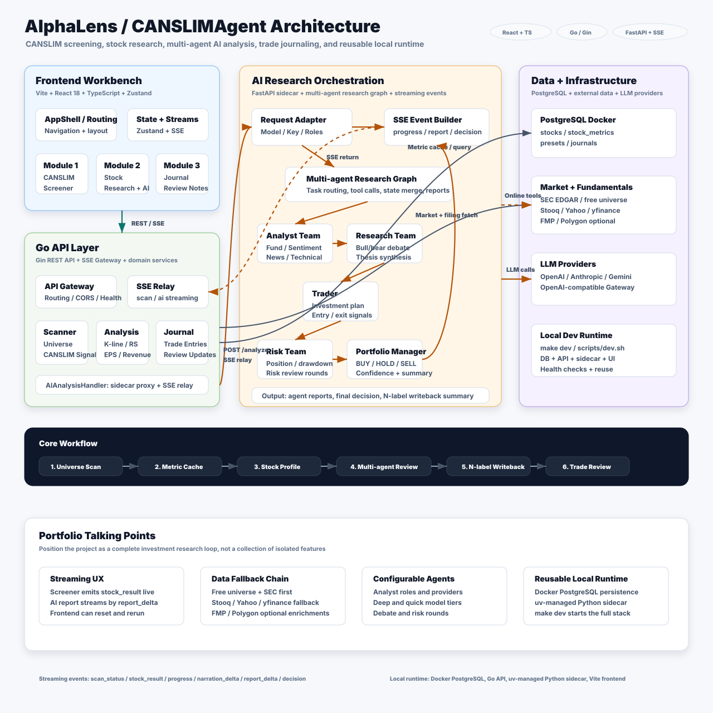
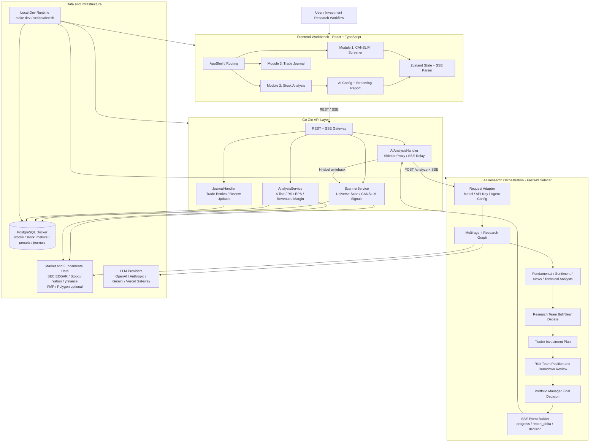

# AlphaLens / CANSLIMAgent Architecture

> Portfolio-ready version: this diagram presents the project as an end-to-end investment research workbench with real-time data flows, persistent research state, and an internal multi-agent AI orchestration layer.

## Portfolio Summary

AlphaLens is a local-first US equity research workbench for the CANSLIM workflow. It combines market universe scanning, metric caching, single-stock research, multi-agent AI analysis, N-label writeback, and trade journaling through a React frontend, Go API layer, Python AI sidecar, and Dockerized PostgreSQL runtime.

## Architecture Highlights

- Frontend workbench: React, TypeScript, Zustand, and SSE parsing for the CANSLIM screener, stock analysis, AI report stream, settings, and trade journal.
- Go API layer: Gin-based REST and SSE gateway for screener scans, stock metrics, chart data, journal records, health checks, and AI sidecar proxying.
- Data and cache layer: Dockerized PostgreSQL persists stocks, metrics, threshold presets, N-label analysis summaries, and trade journal entries.
- Multi-agent research layer: the FastAPI sidecar receives model and role configuration, then orchestrates analyst agents, research debate, trader planning, risk review, and portfolio decision output.
- Streaming UX: the screener emits `scan_status` and `stock_result`; AI analysis emits `progress`, `narration_delta`, `report_delta`, and `decision`.
- Reusable local development: `make dev` / `scripts/dev.sh` starts PostgreSQL, the Go API, the Python sidecar, and the Vite frontend with health checks.

## Mermaid Source

