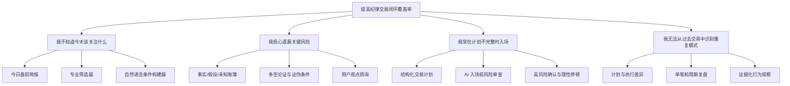

# AlphaLens MVP 机会解决方案树

日期：2026-08-04

使用技能：Opportunity Solution Tree

## 单一期望结果

> 提高真实交易被提前计划、完成风险审查并在交易后得到复盘的比例。

在 MVP 中由“纪律交易闭环覆盖率”衡量，具体口径见 [`06-metrics.md`](06-metrics.md)。

## 机会树

## 机会排序

由于尚无访谈量化数据，以下是定性 Opportunity Score，不能替代用户研究。

| 机会 | 重要性 | 当前满意度 | 战略匹配 | 优先级 |
| --- | --- | --- | --- | --- |
| 计划不完整时入场 | 很高 | 低 | 很高 | 1 |
| 无法从过去交易识别重复模式 | 很高 | 低 | 很高 | 2 |
| 担心遗漏关键风险 | 很高 | 中低 | 很高 | 3 |
| 不知道今天该关注什么 | 高 | 中 | 高 | 4 |

## 每个机会的候选方案

### 机会一：计划不完整时入场

1. 分步结构化计划，区分触发、失效、止损和仓位；
2. 基于字段和市场证据的风险审查；
3. 快速审查与完整审查两种路径；
4. 高风险提醒确认与忽略原因记录；
5. 从历史计划复制模板，但强制更新日期敏感字段。

### 机会二：无法从过去交易识别重复模式

1. 成交自动关联计划，无法关联时标记计划外；
2. 计算计划价格、真实价格、仓位和时间偏差；
3. 一分钟单笔复盘，区分过程与结果；
4. 确定性行为观察：追价、过度交易、持亏、锚定等；
5. 行为观察进入下一次计划审查，并附原始记录。

### 机会三：担心遗漏关键风险

1. 事实、推断、未知和冲突四层研究账簿；
2. 基本面多空论证与反证；
3. 用户自己的观点、待确认问题和证伪条件；
4. 自上次研究以来的变化；
5. AI 输出从“最终决策”改为“研究倾向与未解决问题”。

### 机会四：不知道今天该关注什么

1. 按市场时段组织的今日首页；
2. CANSLIM 作为一个筛选模板；
3. 统一条件模型支持基本面、技术、流动性、波动和事件；
4. 候选入选原因、排除风险和数据新鲜度；
5. 自然语言只负责构建透明条件，不直接荐股。

## 优先实验

### 实验 A：礼宾式入场风险审查

- 假设：具体、证据化的风险审查会促使用户在真实入场前修改计划；
- 方法：5 名目标用户，每人提供 3 份真实计划，由人工加 AI 生成审查；
- 指标：计划实质修改率、提示具体性评分、用户是否仍感到自己拥有决定权；
- 暂定成功阈值：至少 60% 计划发生实质修改，至少 4/5 用户认为提示不是通用建议。

### 实验 B：计划—执行差异原型

- 假设：自动差异比盈亏摘要更能促使用户完成复盘；
- 方法：用 10 笔带计划和成交的历史交易生成差异页，与普通成交列表对比；
- 指标：复盘完成时间、可识别的执行偏差数、再次查看意愿；
- 暂定成功阈值：80% 样本能正确关联，用户在 3 分钟内完成单笔复盘。

### 实验 C：透明筛选条件

- 假设：用户愿意使用自然语言形成思路，但需要看见并修改底层规则；
- 方法：可点击原型对比“黑箱候选”与“条件构建器”；
- 指标：条件理解率、修改率、候选理由召回率；
- 暂定成功阈值：至少 80% 用户能正确解释三个核心条件及其作用。

## 每周更新规则

机会树应在每轮用户访谈或真实使用后更新。新功能只能在能够关联到一个机会和一个可测结果时进入路线图。
