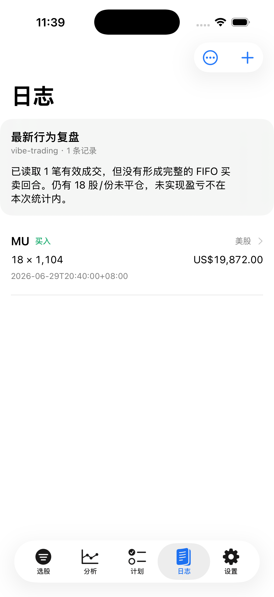
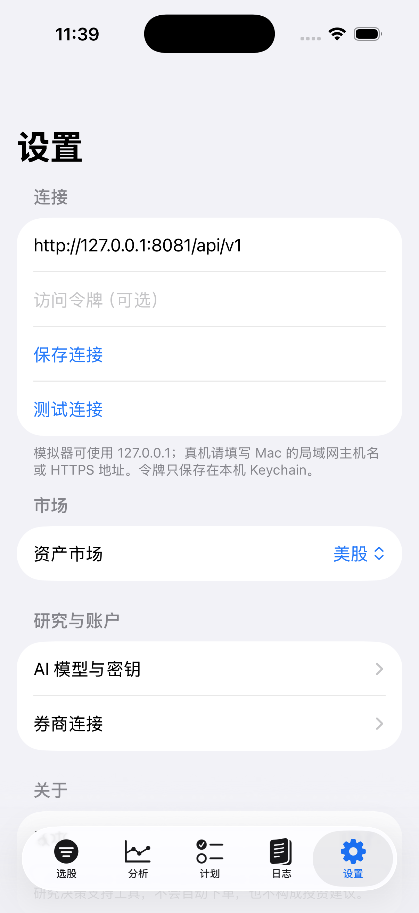

<p align="center">
  <a href="../README.md"></a>
</p>

<p align="center">
  <a href="../README.md"></a>
  <a href="CANSLIMIOS.xcodeproj"></a>
  <a href="../docs/images/ios/README.md"></a>
</p>

AlphaLens iOS 是 Web 工作台的原生 SwiftUI 客户端。它共享现有 Go API、研究数据和
AI 流式协议，但按 iPhone 的导航方式、触控节奏和信息密度重新设计，而不是把桌面页面套进 WebView。

> 当前阶段为可运行的 iOS 17+ 原生工程。研究与账户功能需要连接自行部署的 AlphaLens 后端；
> App 不自动下单，也不构成投资建议。

## 功能覆盖

| 区域 | 原生体验 | 核心能力 |
| --- | --- | --- |
| 选股 | 五栏 Tab、卡片结果、筛选 Sheet | 美股/A 股、CANSLIM 标签、阈值预设、刷新任务、实时扫描 SSE |
| 分析 | 独立详情栈、分段视图、原生 Charts | 公司资料、二层数据、K 线、RS、EPS、营收、毛利率、N 标签 |
| AI 研究 | 配置折叠区、实时状态卡 | 分析师与模型配置、进度、解说、报告、暂停/续传、Markdown 分享 |
| 交易计划 | 表单 Sheet、状态筛选 | 新建、编辑、从分析页预填、记录执行并生成日志 |
| 交易日志 | 原生 List、确认操作 | 手工记录、复盘、行为总结、JSON 导出、删除确认 |
| 设置 | 系统 Form、Keychain | API 连接、市场、LLM 配置、券商连接、同步预览与确认导入 |

## 界面预览

<table>
  <tr>
    <td align="center"><strong>跨市场选股</strong></td>
    <td align="center"><strong>研究图表</strong></td>
    <td align="center"><strong>AI 研究</strong></td>
  </tr>
  <tr>
    <td></td>
    <td></td>
    <td></td>
  </tr>
  <tr>
    <td align="center"><strong>分析到计划</strong></td>
    <td align="center"><strong>交易日志</strong></td>
    <td align="center"><strong>安全设置</strong></td>
  </tr>
  <tr>
    <td></td>
    <td></td>
    <td></td>
  </tr>
</table>

[查看全部截图及 README 使用建议 →](../docs/images/ios/README.md)

## 技术结构

```text
SwiftUI App
├─ 五栏 TabView + NavigationStack
├─ URLSession REST Client
├─ URLSession AsyncBytes SSE Client
├─ Swift Charts
└─ Keychain API Token
        │
        │ /api/v1 · REST + SSE
        ▼
现有 Go API ─ PostgreSQL ─ Python AI Sidecar
```

iOS 端不复制后端业务规则。Web 与 iOS 使用同一套选股含义、研究结果、交易计划、日志、
AI 配置及 `ai-analysis.v1` 流式事件，避免两个客户端产生不同结论。

## 环境要求

- macOS 与 Xcode 26（工程部署目标为 iOS 17）
- iPhone Simulator 或已配置签名的 iPhone
- 已运行的 AlphaLens Go API；AI 分析还需要 Python sidecar 与可用的 LLM 配置

## 本地运行

1. 按[根 README](../README.md#快速体验)启动后端、数据库与 AI sidecar。
2. 打开 [`CANSLIMIOS.xcodeproj`](CANSLIMIOS.xcodeproj)。
3. 选择 `CANSLIMIOS` scheme 和目标设备后运行。
4. 在 App 的“设置”中填写 API 地址并点击“测试连接”。

模拟器默认地址：

```text
http://127.0.0.1:8080/api/v1
```

真机不能用 Mac 的 `127.0.0.1`。请使用 Mac 的局域网主机名/IP，或部署后的 HTTPS 地址。

命令行构建：

```bash
xcodebuild \
  -project ios/CANSLIMIOS.xcodeproj \
  -scheme CANSLIMIOS \
  -sdk iphonesimulator \
  -configuration Debug \
  CODE_SIGNING_ALLOWED=NO \
  build
```

## 深链

App 注册了 `canslim://` scheme，便于从通知、文档或其他客户端直接进入功能页面：

```text
canslim://screener
canslim://analysis/MU?section=overview
canslim://analysis/MU?section=charts
canslim://analysis/MU?section=ai
canslim://plans
canslim://journal
canslim://settings
```

## 安全与数据边界

- 可选内部 API Token 只保存在设备 Keychain，通过 `X-Internal-API-Token` 发送。
- LLM 与券商密钥始终由后端管理；客户端只读取是否已配置，不获取或回显原始密钥。
- 券商同步先展示持仓、成交和警告，必须由用户确认后才导入日志。
- App 不提供下单能力，不把 AI 报告包装成自动交易信号。
- 来源、数据日期、加载失败和能力降级不会因移动端空间有限而隐藏。

## 已验证

- Xcode 26.6 / iOS 26.5 Simulator Debug 构建；
- iPhone 17 完整页面和真实本地 API 数据；
- iPhone 17e 小屏布局、深色模式及 `extra-extra-large` Dynamic Type；
- 选股、分析、图表、AI 配置、计划、日志、设置与分析到计划的触控闭环；
- REST 只读入口和 AI 配置读取；完整付费 AI 调用未在截图流程中触发。

真机签名、局域网连接、真实 LLM 费用调用和券商授权需使用目标环境凭据另行验收。
更详细的功能映射与验证记录见 [`../docs/CANSLIM-IOS.md`](../docs/CANSLIM-IOS.md)。

---

AlphaLens 是研究与决策支持工具，不构成投资建议，不承诺收益，也不会自动执行交易。
