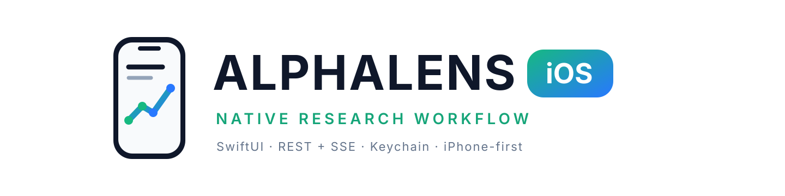
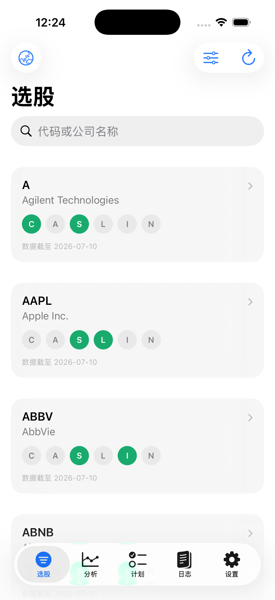
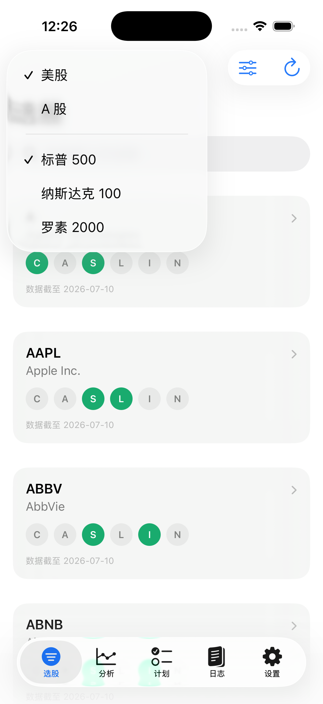
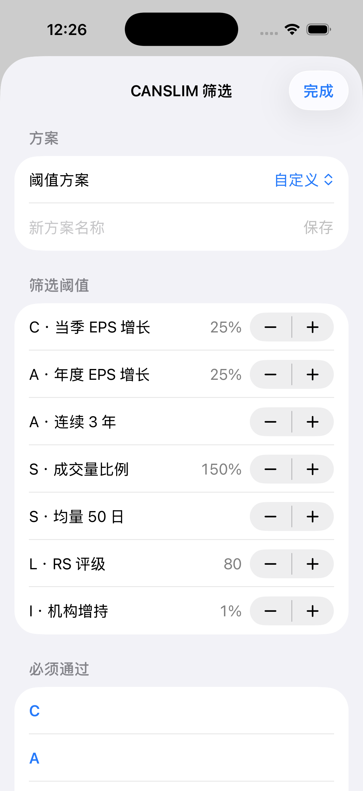
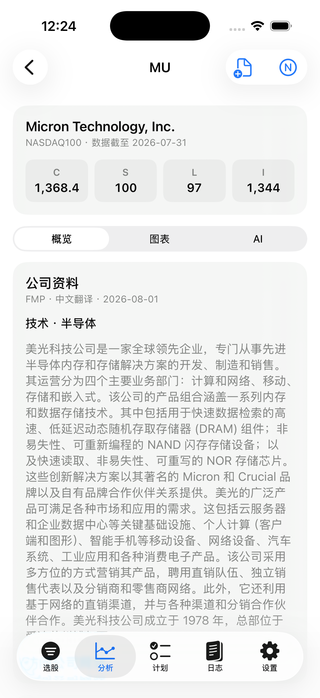
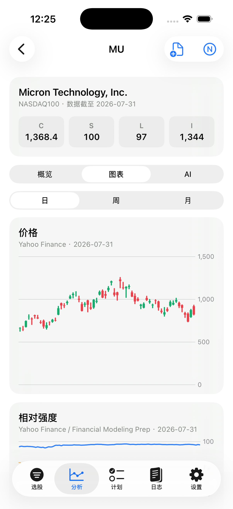
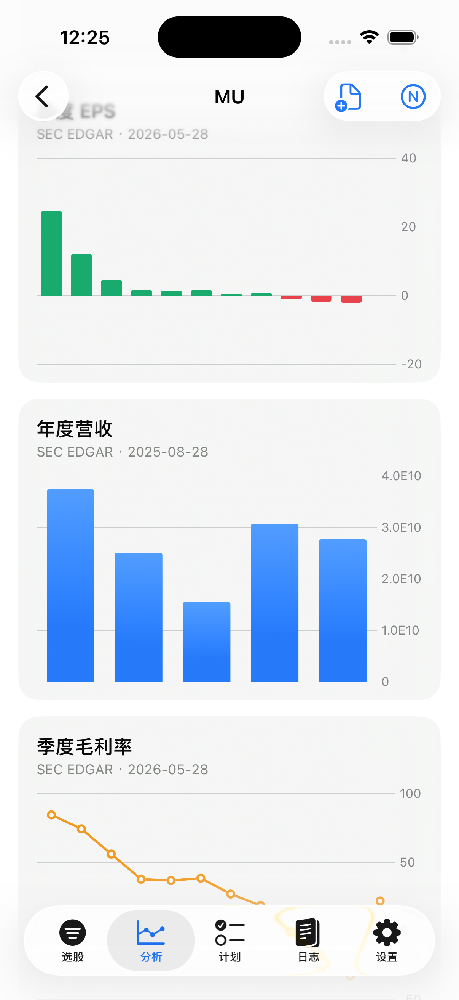
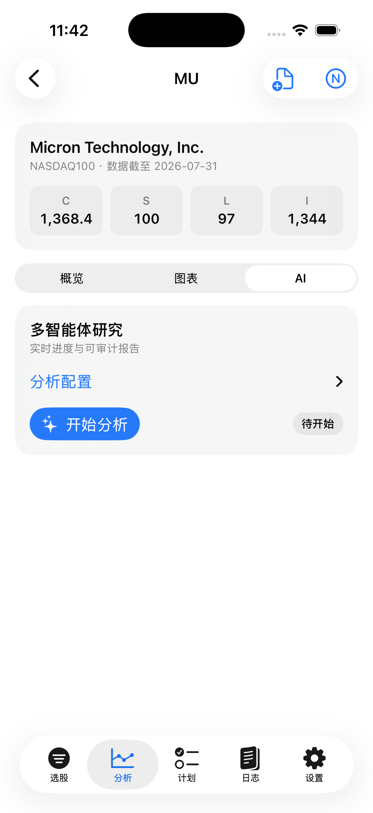
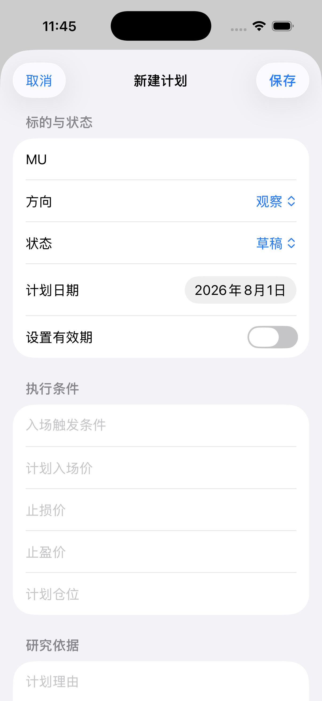
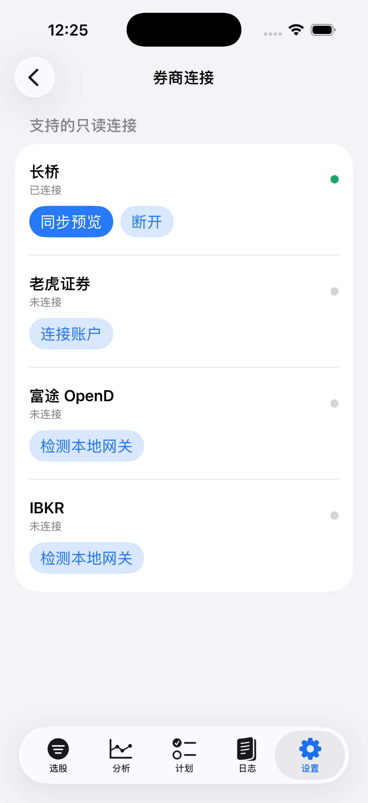

<p align="center">
  <a href="../README.md"></a>
</p>

<p align="center">
  <a href="../README.md"></a>
  <a href="CANSLIMIOS.xcodeproj"></a>
  <a href="../docs/images/ios/README.md"></a>
</p>

AlphaLens iOS 是 Web 工作台的原生 SwiftUI 客户端。它共享现有 Go API、研究数据和
AI 流式协议，但按 iPhone 的导航方式、触控节奏和信息密度重新设计，而不是把桌面页面套进 WebView。

> 当前阶段为可运行的 iOS 17+ 原生工程。研究与账户功能需要连接自行部署的 AlphaLens 后端；
> App 不自动下单，也不构成投资建议。

## 为什么单独做原生 iOS 版本

Web 端适合长时间研究和多区域并排查看；iPhone 更适合随时发现候选、检查证据、跟进研究进度和记录执行。
因此 iOS 端保留完整业务闭环，但重新组织交互：

- 用稳定的五栏 Tab 代替桌面侧栏，让“选股、分析、计划、日志、设置”始终一跳可达；
- 用 `NavigationStack` 承载个股详情，用 Sheet 承载筛选和编辑，返回路径符合 iPhone 使用习惯；
- 优先展示结论状态、关键数值、来源与数据日期，再按需展开配置和详细证据；
- 加载、空数据、后端错误、连接中断、暂停和完成均显示真实状态，不用伪造数据填充界面；
- 保持与 Web 相同的 REST/SSE 契约，任何客户端都不会生成另一套业务口径。

## 完整研究闭环

```text
切换市场与股票池
    ↓
CANSLIM 筛选 / 实时扫描
    ↓
公司资料、价格、RS 与财务证据
    ↓
多智能体 AI 研究与人工复核
    ↓
创建交易计划
    ↓
记录执行 / 导入只读券商成交
    ↓
交易日志与行为复盘
```

研究结果不会直接触发下单。用户始终负责判断是否采纳观点、如何设置风险条件以及是否记录执行。

## 功能总览

| 区域 | 原生体验 | 核心能力 |
| --- | --- | --- |
| 选股 | 五栏 Tab、卡片结果、筛选 Sheet | 美股/A 股、CANSLIM 标签、阈值预设、刷新任务、实时扫描 SSE |
| 分析 | 独立详情栈、分段视图、原生 Charts | 公司资料、二层数据、K 线、RS、EPS、营收、毛利率、N 标签 |
| AI 研究 | 配置折叠区、实时状态卡 | 分析师与模型配置、进度、解说、报告、暂停/续传、Markdown 分享 |
| 交易计划 | 表单 Sheet、状态筛选 | 新建、编辑、从分析页预填、记录执行并生成日志 |
| 交易日志 | 原生 List、确认操作 | 手工记录、复盘、行为总结、JSON 导出、删除确认 |
| 设置 | 系统 Form、Keychain | API 连接、市场、LLM 配置、券商连接、同步预览与确认导入 |

## 功能介绍

### 1. 跨市场 CANSLIM 选股

- 在美股与 A 股之间切换，并只展示当前资产市场支持的股票池；
- 美股覆盖 S&P 500、Nasdaq 100、Russell 2000；A 股覆盖沪深主板、科创板、创业板与北交所；
- 读取服务端已有筛选结果，支持下拉刷新，不需要每次进入页面都重新扫描；
- 按股票代码或公司名称即时搜索；
- 每只股票以独立的 C、A、N、S、L、I 状态呈现，保留数据日期和是否有 AI 报告；
- 支持组合标签过滤，只有同时满足已选择条件的候选才会保留；
- 在筛选 Sheet 中调整季度增长、年度增长与年数、成交量比、均线周期、RS 和机构变化阈值；
- 保存、应用和删除自定义阈值预设；默认预设受到保护，不会被误删；
- 发起后台市场数据刷新，并轮询显示任务完成或失败状态；
- 通过 SSE 实时接收扫描状态、进度和逐只股票结果，可暂停并重新开始；
- 点击任意候选直接进入同一股票的原生分析详情。

### 2. 个股证据工作台

- 可从选股结果进入，也可以在“分析”Tab 直接输入股票代码；
- 顶部汇总公司名称、市场、数据日期和关键 CANSLIM 数值；
- “概览”展示公司行业、业务介绍、官网、来源与更新时间；
- 二层研究数据保留服务端字段、来源和数据日期，未知内容不会显示为零；
- “图表”使用 Swift Charts 展示 K 线与成交量、RS 相对强度、季度 EPS、年度营收和季度毛利率；
- K 线与 RS 支持日、周、月周期切换，并从服务端重新读取对应周期；
- 支持人工更新 N 标签及事件摘要，结论会同步回 Web 端选股结果；
- 所有证据并行加载：摘要先出现，其余资料渐进补齐，单个慢接口不会长期锁住整页；
- 支持下拉刷新，并保留后端返回的可行动错误信息。

### 3. 多智能体 AI 研究

- 自动读取服务端允许使用的供应商、模型、分析师、辩论轮数和在线工具配置；
- 可分别选择深度模型与快速模型，并为兼容网关填写后端地址；
- 可组合基本面、市场、新闻和社交情绪等分析师角色；
- 可调整研究辩论和风险辩论轮数，不在客户端写死分析强度；
- 启动后通过 `ai-analysis.v1` SSE 实时展示角色进度、解说、报告增量和最终建议；
- 展示分析动作、置信度和摘要；仓位与风险条件保留在报告及计划层，避免把方向判断直接误读成投入比例；
- 支持主动暂停；保留 `run_id` 与游标后可继续已有任务，而不是伪装成重新开始；
- 只有收到服务端 `done` 事件才显示完成，断流或错误不会生成虚假的成功结果；
- 支持确认后重新分析，避免无意覆盖已有报告；
- 可把最终摘要写回 N 标签，并导出、分享 Markdown 报告；
- 客户端不执行静态“回测通过”门槛，也不会用占位文案冒充模型输出。

### 4. 交易计划

- 按股票代码搜索，并按草稿、激活、已执行、已取消和已过期等状态过滤；
- 创建或编辑观察、做多、做空方向的交易计划；
- 记录计划日期、有效期、触发条件、计划入场价、止损价、止盈价和仓位；
- 保存计划理由、AI 摘要和补充备注，保留研究到行动之间的依据；
- 可直接从个股分析页创建计划，自动预填股票代码和已有 AI 摘要；
- 执行计划时再次填写实际时间、数量、价格、市场、币种、费用和备注；
- 确认执行后由服务端同步生成交易日志，避免计划与真实记录断裂。

### 5. 交易日志与行为复盘

- 手工录入买入或卖出记录，包括标的、市场、时间、数量、价格、币种、费用与策略标签；
- 列表显示成交方向、数量、价格、金额和时间，点击后进入原生编辑表单；
- 可补充研究笔记和事后复盘，而不覆盖原始成交字段；
- 删除操作使用系统确认，降低误删风险；
- 读取最近一次确定性行为复盘，展示已分析记录数、洞察与警告；
- 可按当前有效日志重新生成行为复盘；
- 可准备并分享兼容 `vibe.trade_record.v1` 的 JSON 导出文件；
- 券商导入与手工日志使用同一数据模型，复盘不会因来源不同而分裂。

### 6. AI 模型与密钥设置

- 展示每个 LLM 供应商的“已配置 / 未配置”状态，不回显原始密钥；
- 可保存或删除服务端加密的 API Key；
- 支持模型发现，读取供应商实际可用模型，而不是只展示客户端内置列表；
- 支持兼容 OpenAI 协议的自定义后端地址；
- 输入与异步状态相互隔离，读取旧状态不会覆盖用户正在编辑的内容。

### 7. 券商只读连接

- 支持长桥、老虎、富途 OpenD 与 IBKR TWS / IB Gateway；
- 长桥和老虎使用服务端生成的 OAuth 跳转，客户端不接触 Client Secret 或 access token；
- 富途和 IBKR 检测用户已经登录的本机网关；
- 连接状态、提示信息和上次同步时间保持可见；
- 同步前先预览持仓、待导入成交和服务端警告；
- 必须由用户点击确认才导入日志，不提供自动下单；
- 断开连接只移除 AlphaLens 保存的授权，不修改券商账户。

### 8. 连接、市场与设备设置

- 修改 API 基地址，并在保存前后执行真实健康检查；
- 可选内部 API Token 存入系统 Keychain，而不是 `UserDefaults` 或源码；
- 全局美股 / A 股市场选择会同步影响选股与分析入口；
- 支持系统深色模式、Dynamic Type、下拉刷新、分享面板和系统确认框；
- 模拟器、真机和部署地址的连接差异会在设置页明确说明。

## 真实界面与功能说明

以下画面来自 iPhone 17 / iOS 26.5 Simulator，并连接本地真实 API。截图保留了数据来源、
数据日期、空状态和连接状态；没有为了展示效果伪造 AI 结论，也没有暴露密钥或券商账户信息。

<table>
  <tr>
    <td align="center"><strong>候选列表</strong></td>
    <td align="center"><strong>市场与股票池</strong></td>
  </tr>
  <tr>
    <td></td>
    <td></td>
  </tr>
  <tr>
    <td align="center"><strong>CANSLIM 阈值</strong></td>
    <td align="center"><strong>公司概览</strong></td>
  </tr>
  <tr>
    <td></td>
    <td></td>
  </tr>
  <tr>
    <td align="center"><strong>价格与相对强度</strong></td>
    <td align="center"><strong>财务趋势</strong></td>
  </tr>
  <tr>
    <td></td>
    <td></td>
  </tr>
  <tr>
    <td align="center"><strong>多智能体研究</strong></td>
    <td align="center"><strong>从分析创建计划</strong></td>
  </tr>
  <tr>
    <td></td>
    <td></td>
  </tr>
  <tr>
    <td colspan="2" align="center"><strong>券商只读连接</strong></td>
  </tr>
  <tr>
    <td colspan="2" align="center"></td>
  </tr>
</table>

### 1. 用 CANSLIM 状态快速浏览候选

选股首页直接显示 A、AAPL、ABBV、ABNB 等真实候选。每张卡片把 C、A、S、L、I、N
拆成独立状态：绿色代表当前条件通过，灰色代表未通过或暂无结论；下方同时显示数据截止日期。
顶部可以切换市场和股票池、搜索代码或公司名称、打开筛选器以及刷新数据。底部五栏导航让选股、
分析、计划、日志和设置始终一跳可达。

### 2. 在一个入口切换市场与指数成分池

市场菜单同时承载资产市场和候选范围。截图中可以在美股与 A 股之间切换；美股下面继续选择
标普 500、纳斯达克 100 或罗素 2000。当前选项使用勾选状态标识，切换后列表按新范围重新读取，
不会把不同市场的候选混在一起。

### 3. 把筛选逻辑变成可检查、可复用的参数

CANSLIM 筛选 Sheet 显示当前阈值方案，并允许逐项调整。截图中的自定义方案包括：当季 EPS
增长 25%、年度 EPS 增长 25%、连续 3 年、成交量比例 150%、50 日均量、RS 评级 80、
机构增持 1%，下方还可以指定必须通过的 C、A 等标签。方案可以命名保存，便于在不同研究场景间复用。

### 4. 先看公司与数据背景，再进入结论

MU 概览顶部给出公司、所属股票池、数据截止日期，以及 C、S、L、I 等关键值。公司资料卡显示
Micron Technology 的行业、中文业务介绍、数据来源 FMP 和翻译日期。来源与日期和正文放在同一层级，
方便判断资料是否足够新，而不是只展示一段无法追溯的摘要。

### 5. 在原生图表中核对价格与相对强度

图表页可以切换日、周、月周期。截图中的日线视图同时展示 MU K 线和相对强度曲线：价格数据来自
Yahoo Finance，RS 结合 Yahoo Finance 与 Financial Modeling Prep，并明确标注数据日期。
继续向下滚动即可查看财务证据，不需要离开个股详情。

### 6. 把增长质量放到同一条时间线上

财务图表继续展示季度 EPS、年度营收和季度毛利率。柱状图用颜色区分正负 EPS，营收和毛利率
分别使用适合的柱状图与折线图；截图中同时保留 SEC EDGAR 来源和各序列日期，便于识别增长、
回落或利润率变化，而不是只看单个当前值。

### 7. 分析前先明确模型、强度和参与角色

AI 页展示从服务端读取的真实配置：Anthropic 供应商、深度/快速模型、研究与风险辩论轮数、
在线工具开关，以及基本面、情绪、新闻、技术等分析师角色。只有配置完成后才启动分析；截图停留在
“待开始”，因此没有为展示而触发付费模型调用。运行后同一页面会继续接收实时进度、报告增量和最终状态。

### 8. 从研究结果直接建立可执行计划

点击个股页右上角的新建计划按钮后，表单自动带入 MU。截图展示了方向“观察”、状态“草稿”、
计划日期和有效期开关，并预留入场触发条件、计划入场价、止损、止盈、仓位与研究依据。
这一步把分析结论转为可复核的条件，但不会自动下单。

### 9. 券商连接只负责同步，不负责交易

券商页清楚区分连接状态和下一步动作：截图中长桥已连接，可以先“同步预览”或主动断开；老虎证券
仍未连接；富途 OpenD 与 IBKR 提供本机网关检测。成交导入前必须先预览并由用户确认，App 不提供
自动下单，也不会在页面上显示 Client Secret、access token 或账户敏感信息。

[查看全部截图、原始尺寸及素材清单 →](../docs/images/ios/README.md)

## 技术结构

```text
SwiftUI App
├─ 五栏 TabView + NavigationStack
├─ URLSession REST Client
├─ URLSession AsyncBytes SSE Client
├─ Swift Charts
└─ Keychain API Token
        │
        │ /api/v1 · REST + SSE
        ▼
现有 Go API ─ PostgreSQL ─ Python AI Sidecar
```

iOS 端不复制后端业务规则。Web 与 iOS 使用同一套选股含义、研究结果、交易计划、日志、
AI 配置及 `ai-analysis.v1` 流式事件，避免两个客户端产生不同结论。

### 主要目录

```text
ios/
├─ CANSLIMIOS.xcodeproj/                Xcode 工程
├─ Config/Info.plist                    本地网络说明与 canslim:// 深链
└─ CANSLIMIOS/
   ├─ DesignSystem/                     颜色、卡片、状态和 Markdown 展示
   ├─ Features/Screener/                选股、筛选、预设、刷新与扫描
   ├─ Features/Analysis/                个股证据、Charts 与 AI 研究入口
   ├─ Features/TradePlans/              交易计划与执行表单
   ├─ Features/Journal/                 日志、导出与行为复盘
   ├─ Features/Settings/                连接、LLM 与券商设置
   ├─ Models/                           REST、图表、AI 与券商数据模型
   └─ Networking/                       API Client、SSE 与 Keychain 设置
```

### 共享接口

| 能力 | iOS 使用的接口 |
| --- | --- |
| 健康检查 | `GET /api/v1/health` |
| 选股与扫描 | `/screener/results`、`/screener/refresh`、`/screener/scan` |
| 个股研究 | `/stocks/{symbol}/summary`、`profile`、`kline`、`rs` 与财务序列 |
| AI 研究 | `GET /analysis/ai/config`、`POST /analysis/{symbol}/ai` |
| 交易计划 | `/trade-plans`、`/trade-plans/{id}/execute` |
| 日志与复盘 | `/journal`、`/journal/export`、`/journal/reflections` |
| AI 凭据 | `/llm/credentials/{provider}`、`/analysis/ai/models` |
| 券商 | `/brokers`、连接、同步预览、导入与断开接口 |

客户端统一处理 snake_case 编解码、API envelope、后端错误消息、超时和可选内部访问令牌。

## 环境要求

- macOS 与 Xcode 26（工程部署目标为 iOS 17）
- iPhone Simulator 或已配置签名的 iPhone
- 已运行的 AlphaLens Go API；AI 分析还需要 Python sidecar 与可用的 LLM 配置

## 本地运行

1. 按[根 README](../README.md#快速体验)启动后端、数据库与 AI sidecar。
2. 打开 [`CANSLIMIOS.xcodeproj`](CANSLIMIOS.xcodeproj)。
3. 选择 `CANSLIMIOS` scheme 和目标设备后运行。
4. 在 App 的“设置”中填写 API 地址并点击“测试连接”。

模拟器默认地址：

```text
http://127.0.0.1:8080/api/v1
```

真机不能用 Mac 的 `127.0.0.1`。请使用 Mac 的局域网主机名/IP，或部署后的 HTTPS 地址。

命令行构建：

```bash
xcodebuild \
  -project ios/CANSLIMIOS.xcodeproj \
  -scheme CANSLIMIOS \
  -sdk iphonesimulator \
  -configuration Debug \
  CODE_SIGNING_ALLOWED=NO \
  build
```

## 深链

App 注册了 `canslim://` scheme，便于从通知、文档或其他客户端直接进入功能页面：

```text
canslim://screener
canslim://analysis/MU?section=overview
canslim://analysis/MU?section=charts
canslim://analysis/MU?section=ai
canslim://plans
canslim://journal
canslim://settings
```

## 安全与数据边界

- 可选内部 API Token 只保存在设备 Keychain，通过 `X-Internal-API-Token` 发送。
- LLM 与券商密钥始终由后端管理；客户端只读取是否已配置，不获取或回显原始密钥。
- 券商同步先展示持仓、成交和警告，必须由用户确认后才导入日志。
- App 不提供下单能力，不把 AI 报告包装成自动交易信号。
- 来源、数据日期、加载失败和能力降级不会因移动端空间有限而隐藏。

## 页面状态与可访问性

- 首次加载使用明确的进度状态；已有内容刷新时不会用全屏遮罩隐藏旧数据；
- 空列表说明下一步可以做什么，错误状态保留重试按钮；
- 破坏性删除、断开连接和重新分析使用系统确认；
- 主要触控目标遵循 44pt 基线，并使用系统按钮、Picker、Toggle、DatePicker 与分享面板；
- VoiceOver 可读取股票代码、公司名称、每个 CANSLIM 标签是否通过及数据日期；
- 系统字体支持 Dynamic Type，颜色同时配合文字或图标表达状态；
- 依赖系统导航与控件反馈，避免持续性装饰动画和干扰阅读的运动效果。

## 常见连接问题

| 现象 | 优先检查 |
| --- | --- |
| `HTTP 404` | API 基地址是否包含正确的 `/api/v1`，端口是否指向 AlphaLens 而不是其他本地服务 |
| `无法连接服务器` | Go API 是否监听、真机是否能访问 Mac 局域网地址、本地网络权限是否允许 |
| AI 配置加载失败 | 先检查 `/api/v1/health`，再检查 Python sidecar 与服务端 AI 上游配置 |
| AI 中途停止 | 查看页面显示的服务端错误；保留 `run_id` 时使用“继续分析” |
| 券商检测失败 | 确认 OpenD、TWS 或 IB Gateway 已登录，并由后端连接 loopback 网关 |
| 真机 Keychain/签名异常 | 使用正式 Development Team 和唯一 Bundle Identifier 重新签名 |

## 已验证

- Xcode 26.6 / iOS 26.5 Simulator Debug 构建；
- iPhone 17 完整页面和真实本地 API 数据；
- iPhone 17e 小屏布局、深色模式及 `extra-extra-large` Dynamic Type；
- 选股、分析、图表、AI 配置、计划、日志、设置与分析到计划的触控闭环；
- REST 只读入口和 AI 配置读取；完整付费 AI 调用未在截图流程中触发。

真机签名、局域网连接、真实 LLM 费用调用和券商授权需使用目标环境凭据另行验收。
更详细的功能映射与验证记录见 [`../docs/CANSLIM-IOS.md`](../docs/CANSLIM-IOS.md)。

---

AlphaLens 是研究与决策支持工具，不构成投资建议，不承诺收益，也不会自动执行交易。
